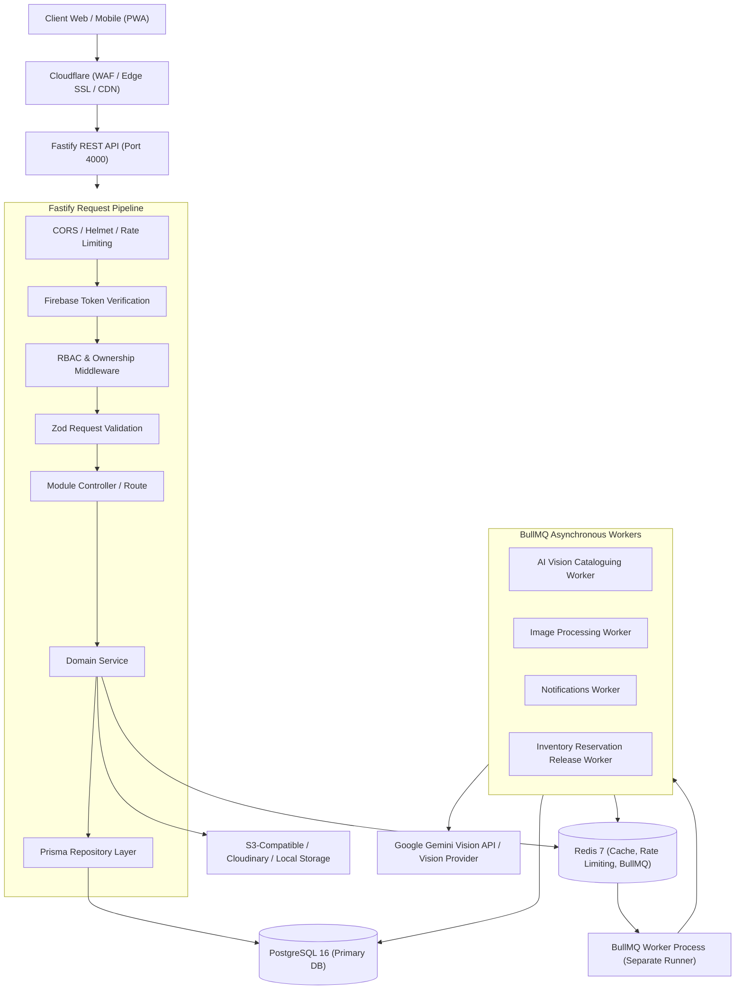

# KAARIGAR AI — ARCHITECTURE SPECIFICATION
## System Architecture, Data Flow, Modular Boundaries, and Architectural Decision Records (ADRs)

### 1. High-Level Architecture Overview



---

### 2. Request-Response Lifecycle Flow

```text
1. Client (Browser / Mobile)
   │ (HTTPS Bearer Token)
   ▼
2. Cloudflare Edge
   │ (SSL Termination, DDoS mitigation, Static CDN)
   ▼
3. Fastify HTTP Gateway
   │
   ├─► Global Middleware:
   │    • @fastify/helmet: Security headers (HSTS, CSP, XSS filter)
   │    • @fastify/cors: Strict domain whitelist
   │    • @fastify/rate-limit: IP & User token sliding-window buckets in Redis
   │    • Request ID injection (x-request-id)
   │
   ├─► Authentication Hook (onRequest / preHandler):
   │    • Extracts 'Authorization: Bearer <id_token>'
   │    • Calls Firebase Admin SDK: admin.auth().verifyIdToken(token, true)
   │    • Resolves or synchronizes local User & ExternalIdentity in PostgreSQL
   │    • Attaches user session context to request: req.user = { id, role, firebaseUid, email }
   │
   ├─► Authorization Hook (preHandler):
   │    • Verifies user role (CUSTOMER | ARTISAN | ADMIN | SUPER_ADMIN) against route policy
   │    • Enforces artisan profile verification requirement where applicable
   │    • Enforces resource ownership checks (e.g., matching req.user.id with resource.artisanId)
   │
   ├─► Validation Hook (preHandler / schema):
   │    • Zod schemas validate req.params, req.query, and req.body
   │    • Automatically transforms and sanitizes inputs
   │    • Throws standardized 400 Bad Request with field-level issues on invalid schema
   │
   ├─► Module Controller & Service Layer:
   │    • Enforces core domain business logic and invariants
   │    • Interacts with Redis for cached queries with graceful degradation
   │    • Executes transactional queries using Prisma $transaction
   │
   ├─► Repository Layer:
   │    • Type-safe Prisma Client queries to PostgreSQL
   │    • Conditional updates and atomic row locking
   │
   ▼
4. Standardized JSON Response (RFC 7807 compliant errors or standardized payload { success: true, data: ... })
```

---

### 3. Module Boundaries & Directory Structure

```text
src/
├── app.ts                  # Fastify application factory, plugin registration & global hooks
├── server.ts               # HTTP server bootstrap, port listening & graceful shutdown
├── config/
│   ├── env.ts              # Zod-validated environment schema
│   ├── logger.ts           # Structured Pino logger with sensitive data redaction
│   └── constants.ts        # System enums, rate limits, timeouts, and minor-unit factors
├── routes/
│   └── v1/                 # Versioned API routes aggregation
│       └── index.ts
├── modules/                # Feature-driven modular monolith boundaries
│   ├── auth/               # Firebase token handling, session context & identity syncing
│   ├── users/              # User profile, addresses, and account preferences
│   ├── artisans/           # Artisan profiles, onboarding, KYC docs, and bank details
│   ├── products/           # Catalog items, variants, images, craft specs
│   ├── categories/         # Hierarchical craft taxonomy & GI tags
│   ├── search/             # Multi-faceted search & filtered catalogue queries
│   ├── catalogue/          # AI catalogue draft jobs, image uploads & draft reviews
│   ├── inventory/          # Stock tracking, atomic reservations & releases
│   ├── carts/              # Customer shopping carts & item calculations
│   ├── orders/             # Order state machine, item snapshots, checkout pipeline
│   ├── payments/           # Payment gateway integration, checkout sessions & webhooks
│   ├── notifications/      # In-app notifications & transactional communications
│   ├── analytics/          # Sales, artisan payouts, and inventory reporting
│   └── admin/              # Artisan verification approvals, category & system management
├── middleware/
│   ├── auth.middleware.ts  # Firebase token verification & user context injection
│   ├── rbac.middleware.ts  # Role-based access control guard
│   └── validate.middleware.ts # Zod validator adapter
├── infrastructure/
│   ├── postgres/           # Prisma client singleton, connection pooling & health checks
│   ├── redis/              # Redis client singleton, cache helpers & health checks
│   ├── firebase/           # Firebase Admin SDK initialization & token verifier
│   ├── queues/             # BullMQ queue definitions, job options & queue factory
│   ├── storage/            # Object storage abstraction (Local, S3, Cloudinary)
│   ├── ai/                 # Vision model provider abstraction (Google Gemini 1.5)
│   └── payments/           # Payment gateway provider abstraction (Razorpay / Stripe)
├── workers/
│   ├── index.ts            # Worker process entrypoint
│   ├── catalogue.worker.ts # AI vision cataloguing worker
│   ├── image.worker.ts     # Image optimization & variant generation worker
│   └── cleanup.worker.ts   # Expired inventory reservation cleanup job
├── plugins/
│   ├── error-handler.ts    # Global Fastify error handler with safe client responses
│   └── swagger.ts          # OpenAPI documentation generator
└── utils/
    ├── response.ts         # Standard API response builders
    ├── idempotency.ts      # Distributed idempotency key guard
    └── crypto.ts           # Webhook signature verification and hash helpers
```

---

### 4. Architectural Decision Records (ADRs)

#### ADR-001: Modular Monolith with Separate Worker Process
- **Context:** The application needs rapid feature iteration, strict relational integrity for commerce and inventory, and background processing for compute-heavy AI vision jobs.
- **Decision:** Use a single modular monolith codebase with distinct business module boundaries, but run two decoupled OS processes:
  1. `server.ts`: Handles low-latency HTTP REST requests.
  2. `workers/index.ts`: Consumes BullMQ queues asynchronously.
- **Consequences:** Easy local development, zero inter-service network latency for synchronous business flows, while keeping heavy AI jobs from starving Fastify's event loop.

#### ADR-002: PostgreSQL as the Single Primary Application Database
- **Context:** Need strict ACID transactions for payments, inventory reservations, order processing, and complex relational craft hierarchies.
- **Decision:** PostgreSQL 16 via Prisma ORM. No MongoDB or secondary databases.
- **Consequences:** Full transactional safety, foreign key guarantees, rich indexing, and strict schema migrations.

#### ADR-003: Redis as Ephemeral Cache and BullMQ Backend Only
- **Context:** High read throughput on public product catalogues and need for distributed background queues.
- **Decision:** Redis is strictly an ephemeral layer. No critical domain state or master records reside solely in Redis.
- **Consequences:** If Redis restarts or drops connections, the system degrades gracefully by reading from PostgreSQL.

#### ADR-004: Firebase Admin SDK for Server-Side Identity Verification
- **Context:** Client sign-in uses Google Firebase Authentication.
- **Decision:** Backend never trusts client assertions or raw UIDs. The frontend provides a short-lived Firebase ID token; the backend verifies cryptographic validity, expiry, and revocation via Firebase Admin SDK.
- **Consequences:** Secure token authentication without managing raw user passwords, while maintaining local `User` and `ExternalIdentity` records in PostgreSQL.

#### ADR-005: Two-Phase Atomic Inventory Reservation
- **Context:** Preventing overselling of handcrafted one-of-a-kind artisan goods during concurrent checkouts.
- **Decision:** Checkout initiates a two-phase reservation:
  1. `quantity` decremented and `reserved_quantity` incremented atomically with conditional SQL check (`WHERE quantity >= $needed`).
  2. A 15-minute reservation TTL is tracked. If payment succeeds, reservation is finalized. If payment fails or times out, a worker releases the reservation back to available quantity.
- **Consequences:** Zero overselling, fair customer experience, and automatic stock recovery.

#### ADR-006: Asynchronous AI Vision Pipeline with Strict Schema Validation
- **Context:** AI models can return unpredictable or malformed outputs, and vision calls take 2-10 seconds.
- **Decision:** AI cataloguing runs completely out-of-band via BullMQ. Output is strictly validated against a Zod schema before saving to PostgreSQL.
- **Consequences:** HTTP requests return immediately with a job ID; workers retry transient network errors with exponential backoff; artisan receives verified structured drafts.
