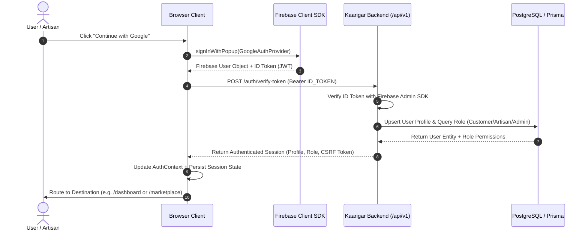

# KAARIGAR AI — SYSTEM ARCHITECTURE SPECIFICATION

**System:** `kaarigar-frontend`  
**Framework:** Next.js 16+ (App Router), React 19, TypeScript (Strict), Tailwind CSS  
**Architectural Model:** Modular Feature-Driven Clean Architecture  

---

## 1. ROUTE TOPOLOGY & ROUTING SPECIFICATION

The application organizes routes into explicit functional domains with layout encapsulation:

```text
src/app/
├── (marketing)/                      # Public marketing & editorial pages
│   ├── layout.tsx                    # Shared marketing header + footer
│   ├── page.tsx                      # Homepage (Hero, Trending, Featured, Stories)
│   ├── about/page.tsx                # Artisan Mission & Heritage Preservation
│   └── contact/page.tsx              # Artisan inquiry & customer support
├── marketplace/                      # E-Commerce Catalog & Discovery
│   ├── page.tsx                      # All products with multi-facet filters & sorting
│   └── [category]/page.tsx           # Category-specific landing (textiles, pottery, etc.)
├── product/
│   └── [slug]/page.tsx               # Product Detail Page (gallery, artisan bio, reviews)
├── artisans/
│   ├── page.tsx                      # Artisan Directory (regional filter, craft filter)
│   └── [slug]/page.tsx               # Artisan Dedicated Profile & Portfolio
├── search/
│   └── page.tsx                      # Dedicated Search Results & Instant Filter View
├── (auth)/                           # Authentication & Onboarding
│   ├── login/page.tsx                # Google Sign-in & Email authentication
│   ├── register/page.tsx             # Role selection (Customer vs Artisan)
│   └── onboarding/page.tsx           # Multi-step Artisan Studio Onboarding
├── cart/
│   └── page.tsx                      # Interactive Cart with live discount & impact calculation
├── checkout/
│   └── page.tsx                      # Secure Checkout with address validation & payment methods
├── account/                          # Customer Account Portal
│   ├── layout.tsx                    # Account navigation sidebar
│   ├── page.tsx                      # Overview & recent orders
│   ├── orders/page.tsx               # Full order history
│   ├── orders/[id]/page.tsx          # Order tracking & itemized invoice
│   ├── wishlist/page.tsx             # Saved items grid with 1-click cart transfer
│   └── settings/page.tsx             # Profile, addresses, notification toggles
├── dashboard/                        # Artisan Studio & Business Portal
│   ├── layout.tsx                    # Artisan sidebar & studio header
│   ├── page.tsx                      # Business KPIs, revenue, active listings
│   ├── products/page.tsx             # Product catalogue management table
│   ├── products/new/page.tsx         # Manual product creation
│   ├── ai-catalogue/page.tsx         # AI-powered visual craft analyzer & listing generator
│   ├── inventory/page.tsx            # Stock monitoring & threshold alerts
│   ├── orders/page.tsx               # Incoming customer orders & dispatch workflow
│   ├── insights/page.tsx             # Analytics & craft demand trends
│   └── settings/page.tsx             # Workshop details, payout bank accounts
├── admin/                            # Platform Governance & Curation
│   ├── layout.tsx                    # Admin layout with security guard
│   ├── page.tsx                      # Platform GMV & key metrics
│   ├── artisans/page.tsx             # Artisan KYC verification workflow
│   ├── products/page.tsx             # Product moderation queue
│   ├── orders/page.tsx               # Platform-wide order resolution
│   └── audit-logs/page.tsx           # System & security audit logs
├── privacy/page.tsx                  # Privacy Policy
├── terms/page.tsx                    # Terms of Service
├── loading.tsx                       # Global page skeleton
├── error.tsx                         # Error boundary with retry
├── not-found.tsx                     # Culturally styled 404 page
├── layout.tsx                        # Root layout with providers & fonts
└── globals.css                       # Design tokens & styling
```

---

## 2. COMPONENT & LAYER HIERARCHY

```text
src/
├── components/
│   ├── ui/                           # Primitive reusable design system components
│   │   ├── button.tsx
│   │   ├── badge.tsx
│   │   ├── card.tsx
│   │   ├── input.tsx
│   │   ├── dialog.tsx
│   │   ├── skeleton.tsx
│   │   ├── toast.tsx
│   │   └── tabs.tsx
│   ├── layout/                       # Structural layout elements
│   │   ├── navbar.tsx                # Main navigation with search, location, cart badge
│   │   ├── footer.tsx                # Editorial footer with newsletter & credentials
│   │   ├── mobile-nav.tsx            # Responsive mobile drawer
│   │   └── breadcrumbs.tsx
│   ├── marketplace/                  # Marketplace discovery components
│   │   ├── product-card.tsx          # Authentic craft card with artisan provenance
│   │   ├── category-card.tsx         # Visual craft category pill/card
│   │   ├── filter-sidebar.tsx        # Faceted filters
│   │   └── sort-dropdown.tsx
│   ├── artisans/                     # Artisan presentation components
│   │   ├── artisan-card.tsx
│   │   └── craft-badge.tsx
│   ├── dashboard/                    # Studio & admin widgets
│   │   ├── stat-card.tsx
│   │   └── studio-sidebar.tsx
│   └── feedback/                     # Alert banners, loading overlays
├── features/                         # Business domain state & logic modules
│   ├── auth/
│   ├── products/
│   ├── search/
│   ├── cart/
│   ├── orders/
│   ├── wishlist/
│   ├── ai-catalogue/
│   └── dashboard/
├── lib/
│   ├── api/                          # HTTP client, OpenAPI spec bindings, mock fallback
│   ├── firebase/                     # Firebase Auth client SDK initializer
│   ├── auth/                         # Token session management & route guards
│   ├── validation/                   # Zod validation schemas
│   ├── formatting/                   # Currency (INR), date, craft dimension formatters
│   └── utilities/                    # cn, slugify, debounce helpers
```

---

## 3. DATA FLOW & RENDERING ARCHITECTURE

### 3.1 Client-Server Rendering Strategy
1. **Public Marketing & SEO Routes:** Default to React Server Components (RSC) for zero-JS footprint, optimized metadata generation, and instant Time-to-First-Byte (TTFB).
2. **Interactive Catalog & Search:** Client boundary mounted below header; URL search params synchronize filter state without full-page reloads.
3. **Studio & Account Dashboards:** Client Components wrapped in route guard context to ensure verified token session before data hydration.

---

## 4. FIREBASE AUTHENTICATION & TOKEN FLOW



---

## 5. API CLIENT & RESILIENT FALLBACK ARCHITECTURE

The frontend utilizes a typed API client (`lib/api/client.ts`) designed with graceful fallback capabilities:

```mermaid
graph TD
    A[Client Request: api.getProducts()] --> B{Is NEXT_PUBLIC_API_URL configured & reachable?}
    B -- Yes --> C[HTTP Request to Fastify Backend with Bearer JWT]
    C --> D{Response Status}
    D -- 200 OK --> E[Parse & Validate with Zod]
    D -- Network Error / 5xx --> F[Graceful Mock Data Fallback with Warning Log]
    B -- No / Offline Mode --> G[Local In-Memory Fixture Repository]
    G --> H[Return Authenticated / Artisan-Curated Mock Data]
    E --> I[Return Typed Entity to UI Component]
    F --> I
    H --> I
```

---

## 6. STATE MANAGEMENT STRATEGY

1. **Server Cache & Routing:** Next.js Route Cache, Static Site Generation (SSG), and dynamic revalidation.
2. **URL Search Parameters (`nuqs` / `useSearchParams`):** Primary state holder for catalog filters, search keywords, sorting mode, and pagination. Ensures 100% shareable links.
3. **React Context Layer:**
   - `AuthContext`: Firebase user credentials, backend profile, user role.
   - `CartContext`: Current items, quantities, promo code, subtotal, artisan impact.
   - `WishlistContext`: Bookmarked items with optimistic updates.
   - `LocationContext`: Selected delivery location (e.g., "Bhopal, MP") with pincode validator.
4. **Local State (`useState` / `useReducer`):** Form validation, UI modals, image gallery previews, and AI analysis steps.

---

## 7. SECURITY ARCHITECTURE & BOUNDARIES

1. **Client Boundary Isolation:** Strictly zero server secrets (`DATABASE_URL`, `REDIS_URL`, `FIREBASE_ADMIN_PRIVATE_KEY`) in frontend repository.
2. **Public Configuration:** Only `NEXT_PUBLIC_*` variables are exposed to client code.
3. **Token Transmission:** Firebase ID tokens transmitted solely over HTTPS in Authorization headers (`Bearer <token>`).
4. **Input Sanitization:** All user inputs (search, reviews, artisan bio, product details) validated via Zod schemas prior to dispatch.
5. **Route Protection:** Client-side layout route guards intercept unauthorized access to `/dashboard/*` (Artisans only), `/admin/*` (Admins only), and `/account/*` (Authenticated users only), redirecting to `/login` with return URL.
