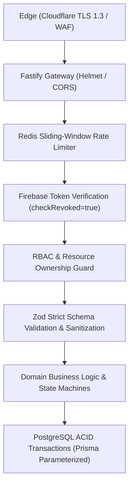

# KAARIGAR AI — SECURITY & THREAT MODEL SPECIFICATION

### 1. Security Architecture & Threat Model

Kaarigar AI handles sensitive customer contact details, artisan identity credentials (Aadhaar/Artisan IDs), bank payout details, and financial order transactions. The security posture follows defense-in-depth across the entire stack.

---

### 2. STRIDE Threat Model & Mitigations

| Threat Category | Potential Attack Vector | Kaarigar AI Mitigation |
| :--- | :--- | :--- |
| **Spoofing** | Forged user identity or forged payment webhook | Firebase Admin SDK cryptographically verifies token signature, expiry, and audience. Webhooks require HMAC-SHA256 signature verification with stored secret. |
| **Tampering** | Modifying price or stock during cart/checkout | Prices are strictly calculated on the server from the database. Client-submitted prices are ignored. Inventory updates use row-level locks. |
| **Repudiation** | Denying an administrative action or payment confirmation | All administrative approvals, verification updates, and payment webhook payloads are recorded in the immutable `AuditLog` and `PaymentWebhookEvent` tables. |
| **Information Disclosure** | IDOR (Insecure Direct Object Reference) or stack trace leak | Strict resource-ownership checks in middleware. Global error handler sanitizes stack traces and internal errors in production. |
| **Denial of Service** | Flooding heavy AI vision endpoints or brute forcing | Redis-backed sliding-window rate limiting per IP and per authenticated user ID. Strict file size and MIME-type restrictions on uploads. |
| **Elevation of Privilege** | Normal customer attempting artisan publishing or admin actions | RBAC middleware checks roles server-side on every protected route. Super-admin provisioning is strictly protected and cannot be self-assigned. |

---

### 3. Authentication Policy

1. **Identity Provider:** Firebase Authentication is the sole external identity provider for Google sign-in.
2. **Server-Side Token Verification:**
   - On every request to protected routes, the `auth.middleware.ts` extracts the Bearer token.
   - Verified via `firebase-admin.auth().verifyIdToken(token, true)` to enforce `checkRevoked = true`.
   - The token contains: `sub` (Firebase UID), `email`, `email_verified`, `name`, `picture`.
3. **Local User Synchronization:**
   - The verified Firebase UID is matched against `ExternalIdentity` in PostgreSQL.
   - If not found, a new local `User` record is created atomically with default role `CUSTOMER`.
   - Never trust client-submitted UIDs or roles. Roles are stored and resolved exclusively from PostgreSQL.
4. **Session Expiry & Revocation:**
   - Expired or revoked Firebase tokens immediately return `401 UNAUTHORIZED`.
   - Disabled accounts (`User.status != ACTIVE`) are blocked at the middleware layer.

---

### 4. Authorization & Access Control (RBAC + ABAC)

#### 4.1 Role Hierarchy
- `CUSTOMER`: Default role. Can view public catalogues, manage own cart, wishlist, addresses, and view own orders.
- `ARTISAN`: Can register an artisan profile, upload craft photos for AI cataloguing, view drafts, and manage own products/inventory once verified.
- `ADMIN`: Can review artisan onboarding, approve/reject verification status, manage categories, and view platform metrics.
- `SUPER_ADMIN`: Root platform manager. Can manage admin accounts, audit logs, and critical system settings.

#### 4.2 Resource-Level Ownership Rules (ABAC)
- **Orders:** A user can only fetch `GET /api/v1/orders/:id` if `order.userId === req.user.id` or if `req.user.role IN [ADMIN, SUPER_ADMIN]`. Artisans can view only line items belonging to their workshop.
- **Addresses & Cart:** Scoped strictly to `req.user.id`.
- **Artisan Products:** An artisan can update/delete only products where `product.artisanId === req.user.artisanProfile.id`.
- **Verification Gate:** An artisan with `status != VERIFIED` is prohibited from creating `PUBLISHED` products. Attempting to publish returns `403 FORBIDDEN: Artisan account pending verification`.

---

### 5. Payment & Webhook Security

- **Card Data:** Kaarigar AI **NEVER** accepts, processes, or stores payment card numbers, CVVs, or bank login credentials. All card handling occurs directly within the PCI-DSS compliant payment gateway SDK/hosted iframe.
- **Webhook Cryptographic Verification:**
  - Webhooks from payment providers (Razorpay / Stripe) are verified using HMAC-SHA256 signatures over the raw request payload.
  - Invalid signatures return `400 BAD REQUEST` and are logged as security alerts.
- **Event Deduplication:**
  - Each incoming webhook event ID is recorded in `PaymentWebhookEvent`.
  - A unique constraint on `(provider, eventId)` prevents replay attacks.

---

### 6. Data Integrity & Validation

- **Zod Validation:** Every endpoint validates request parameters, query strings, and request bodies before domain logic executes. Unrecognized properties are stripped.
- **SQL Injection Prevention:** Prisma ORM uses parameterized SQL queries exclusively. Raw SQL queries are avoided or strictly parameterized.
- **XSS & HTTP Hardening:** `@fastify/helmet` enforces Content-Security-Policy (CSP), Strict-Transport-Security (HSTS), X-Content-Type-Options: nosniff, and Referrer-Policy.
- **CORS Whitelist:** Configured via `CORS_ORIGIN` to accept only authorized frontend origins in production.

---

### 7. Audit Logging & Secrets Management

- **Audit Logs:** Actions modifying artisan status, refunding payments, or altering permissions write an append-only entry to `AuditLog`.
- **Secrets Management:** Secrets (`DATABASE_URL`, `REDIS_PASSWORD`, `FIREBASE_PRIVATE_KEY`, `PAYMENT_KEY_SECRET`) are loaded at runtime from environment variables and validated through `src/config/env.ts`. No credentials are committed to version control.
- **Log Redaction:** Pino logger redacts sensitive fields: `authorization`, `cookie`, `password`, `privateKey`, `cardNumber`, `accountNumber`.
